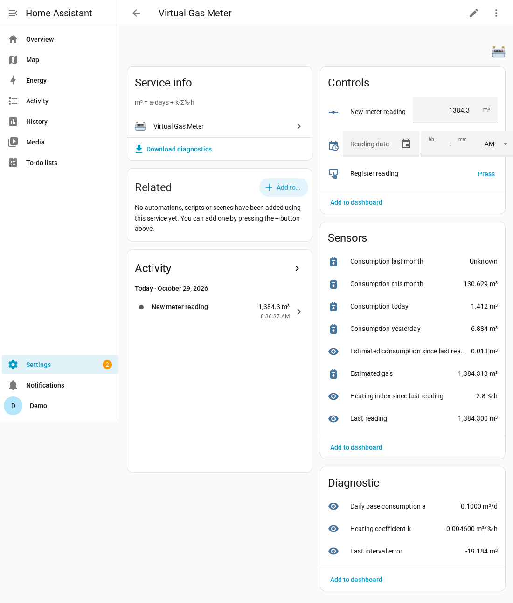

# Virtual Gas Meter (Contatore gas virtuale)

Integrazione per Home Assistant che stima in tempo reale il consumo di gas dalla potenza di
riscaldamento (%) di valvole/zone (qualsiasi marca, es. tado X) e si riallinea a ogni
lettura reale del contatore. Interfaccia tradotta in italiano.

Documentazione completa (in inglese), con schermate e tabella delle entità: [README.md](README.md).

**Modello:** `m³ = a·giorni + k·I`, con `I` = somma delle % integrate nel tempo (%·h).
I valori iniziali (a = 0,1 m³/giorno, k = 0,005 m³/%·h) sono solo indicativi: a ogni lettura
k viene ricalcolato ai minimi quadrati (`k = ΣI·(m³ − a·d)/ΣI²`); se *a fisso* è disattivato
vengono stimati a e k insieme. Più letture inserisci, più la stima migliora.

**Sensori senza dati:** se un sensore è `unavailable`/`unknown` (per esempio durante
un'interruzione del cloud del termostato), la sua potenza non vale 0 %: viene stimata dal
suo profilo orario (lo stesso orario dei giorni precedenti, inizializzato dalle statistiche
degli ultimi 7 giorni). Le ore stimate compaiono nell'attributo `estimated_hours`. Se più
del 10 % di un intervallo è stimato, quell'intervallo viene escluso automaticamente dal
ricalcolo di k; con il servizio `exclude_reading` puoi escludere o includere una lettura a mano.

**Installazione:** HACS → *Repository personalizzati* → `https://github.com/nebbiadigiorno/ha-virtual-gas-meter` (categoria Integrazione),
oppure copia `custom_components/virtual_gas_meter` in `config/custom_components/`; riavvia.

**Configurazione:** *Impostazioni → Dispositivi e servizi → Aggiungi integrazione → Virtual
Gas Meter*: scegli i sensori con unità %, a e k, ultima lettura e data.

**Letture:** campo *Nuova lettura contatore* + *Data lettura* (facoltativa) + pulsante
*Registra lettura*, oppure i servizi `virtual_gas_meter.register_reading`
(`reading`, `date`), `delete_reading` (`date`), `exclude_reading` (`date`, `exclude`),
`recalculate`.

**Pannello Energia:** usa il sensore *Gas stimato* (`total_increasing`, non scende mai: se una lettura è inferiore alla stima, il valore resta fermo finché la stima non la raggiunge).

**Limiti:** è una stima, non una misura certificata; non usarla per la fatturazione.

Licenza MIT.
