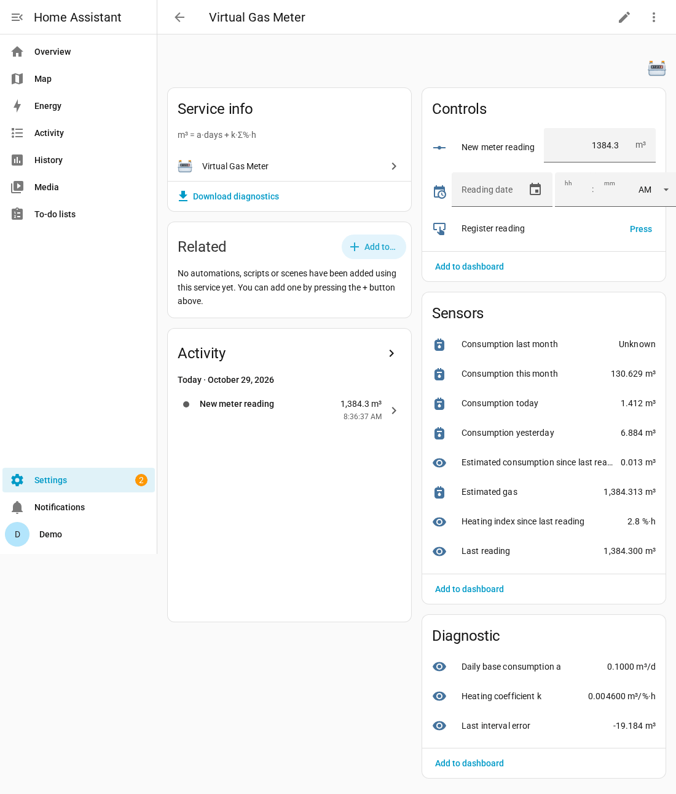
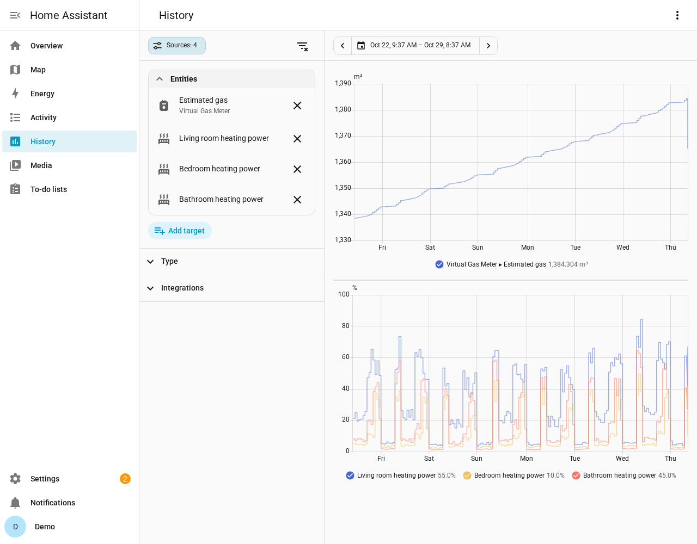
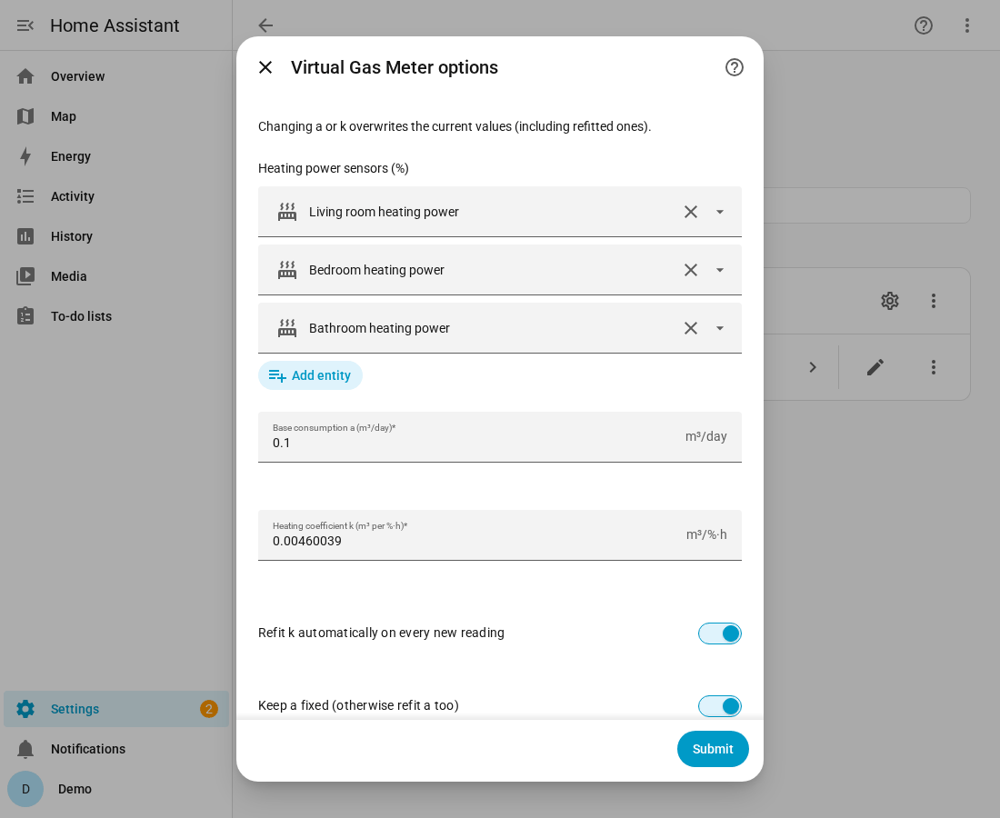
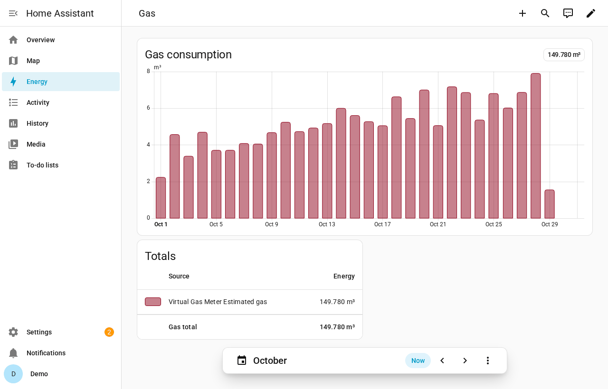

# Virtual Gas Meter

[](https://hacs.xyz/docs/faq/custom_repositories)
[](https://github.com/nebbiadigiorno/ha-virtual-gas-meter/actions/workflows/validate.yml)

A Home Assistant custom integration that gives you a **virtual gas meter** when the real
one has no smart reader. It estimates gas consumption in real time from the heating power
(%) reported by your thermostatic radiator valves or heating zones. Every time you type in
a real meter reading, it **calibrates itself** against it.

It works with any sensor whose unit is `%`, for example tado X `sensor.*_heating_power`.
Any brand will do. The result is a regular `gas` sensor you can add to the
**Energy dashboard**.

🇮🇹 Italiano: [README.it.md](README.it.md)



> All screenshots come from a demo Home Assistant instance with synthetic data.

## Features

- **Real-time estimate** of gas use (m³) from any number of heating-power sensors.
- **Self-calibration:** each new meter reading refits the heating coefficient by least
  squares over your whole reading history.
- **Never-decreasing total** (`total_increasing`), safe for the Energy dashboard and
  long-term statistics.
- **Gap backfill:** after a restart or downtime, the missed heating index is rebuilt
  from recorder statistics.
- **Period sensors:** today, yesterday, this month and last month, each split into a base
  share and a heating share.
- **Diagnostics:** the current coefficients `a` and `k`, the error of the last closed
  interval, and the full reading history as attributes.
- **UI controls and services** to register, delete or recalculate readings.
- English and Italian translations, UI-only setup (config flow) and HACS support.

## How it works

### The model

    consumption (m³) = a · days + k · I

| Symbol | Meaning |
| --- | --- |
| `a` | Daily base consumption (hot water, cooking), m³/day |
| `I` | Heating index: the sum over all selected sensors of their % integrated over time (%·h). `unavailable`/`unknown` count as 0 |
| `k` | Heating coefficient: m³ of gas per %·h |

For example, a valve at 50 % for 2 hours adds 100 %·h to the index. With k = 0.005, that
equals 0.5 m³.

### Self-calibration

The defaults (a = 0.1 m³/day, k = 0.005 m³/%·h) are **only rough starting points** and are
not calibrated for any particular home. With *Refit k automatically on every new reading*
enabled (the default), each reading closes an interval with a known real consumption.
k is then refitted by least squares over all valid intervals, with a fixed:

    k = Σ I·(m³ − a·d) / Σ I²

If *Keep a fixed* is turned off, a and k are fitted together. This needs at least 3 valid
intervals. The more readings you enter, the better the estimate gets. Readings taken a
few weeks apart during the heating season work best. The *Last reading* entity keeps the
history of every interval: estimated vs. real m³ and the error.

### A total that never decreases

**Estimated gas** is `last reading + estimate since then`. When you register a real
reading:

- if the reading is **above** the estimate, the meter steps up to the real value;
- if the reading is **below** the estimate, the published value is **held** until the
  estimate catches up (attribute `compensation_active: true`), so the meter never goes
  backwards and your Energy statistics stay clean.



## Installation

### HACS (custom repository)

1. Open HACS, go to ⋮ → *Custom repositories* and add
   `https://github.com/nebbiadigiorno/ha-virtual-gas-meter` with category **Integration**.
2. Search for **Virtual Gas Meter**, download it and restart Home Assistant.

### Manual

Copy `custom_components/virtual_gas_meter` into `<config>/custom_components/` and restart
Home Assistant.

Requirements: Home Assistant 2025.1 or newer, and the `recorder` integration (enabled by
default), whose statistics are used for backfilling.

## Configuration

Go to *Settings → Devices & services → Add integration → Virtual Gas Meter*, then:

1. Select one or more heating-power sensors (unit `%`). Sensors with a different unit are
   rejected.
2. Keep the default a and k or enter your own.
3. Enter your most recent real meter reading (m³) and when you took it.

You can change the sensors, a, k, *Refit k automatically* and *Keep a fixed* later under
**Configure**. Only one instance is supported.



## Entities

| Entity | Type | Description |
| --- | --- | --- |
| Estimated gas | sensor (m³, `gas`, `total_increasing`) | The virtual meter. Attributes: `raw_estimate`, `compensation_active`, `last_update` |
| Heating index since last reading | sensor (%·h) | Index I accumulated since the last reading |
| Estimated consumption since last reading | sensor (m³) | a · days + k · I since the last reading |
| Last reading | sensor (m³) | Last real reading. Attributes: `date` and `readings` (date, value, index, days, m3, estimated_m3, error_m3, excluded_from_fit for each reading) |
| Consumption today / yesterday / this month / last month | sensor (m³) | Model increments per period. Attributes: `period`, `base_share`, `heating_share`, `heating_index`, `start_time`, `hours_without_data` |
| Daily base consumption a | diagnostic sensor (m³/d) | Current a |
| Heating coefficient k | diagnostic sensor (m³/%·h) | Current k |
| Last interval error | diagnostic sensor (m³) | Estimate − real for the last closed interval. Attributes: `date`, `estimated_m3`, `real_m3`, `error_percent` |
| New meter reading | number (m³) | Value to register |
| Reading date | datetime | Optional date/time of the reading (empty = now) |
| Register reading | button | Saves the reading and recalibrates |

Periods follow Home Assistant's time zone, so DST days last 23 or 25 h. A new k applies
from that moment on. Daily and monthly values that have already accumulated are not
restated.

## Registering readings

**From the UI:** type the value into *New meter reading*, optionally set *Reading date*,
then press *Register reading*. Readings that are lower than the previous one, older than
the last reading or in the future are rejected.

**Services:**

```yaml
action: virtual_gas_meter.register_reading
data:
  reading: 1234.567
  date: "2025-01-31 20:00:00"   # optional, local time; default: now
```

| Service | Fields | Description |
| --- | --- | --- |
| `virtual_gas_meter.register_reading` | `reading` (m³), `date` (optional), `config_entry_id` (optional) | Register a real meter reading and recalibrate |
| `virtual_gas_meter.delete_reading` | `date` (day or exact date/time) | Delete a reading; its interval is merged into the next one |
| `virtual_gas_meter.recalculate` | – | Refit the coefficients now |

## Energy dashboard

Add **Estimated gas** under *Settings → Dashboards → Energy → Gas consumption*. Because the
total never decreases, the daily and monthly bars stay consistent even after
recalibrations.



## Accuracy and limitations

This is an **estimate**, not a certified measurement. Its accuracy depends on how closely
the heating % tracks the boiler's actual gas use. Boiler modulation and efficiency, hot
water use, outdoor temperature and rooms without sensors all affect it. Expect larger
errors with only a few readings or outside the heating season. **Do not use it for
billing.**

## Development

```bash
pip install pytest-homeassistant-custom-component ruff
ruff check .
pytest
```

## License

MIT – see [LICENSE](LICENSE).
